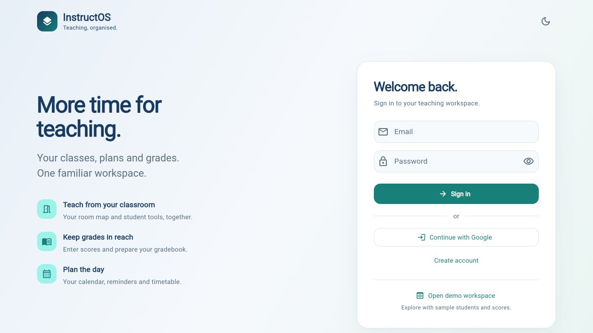
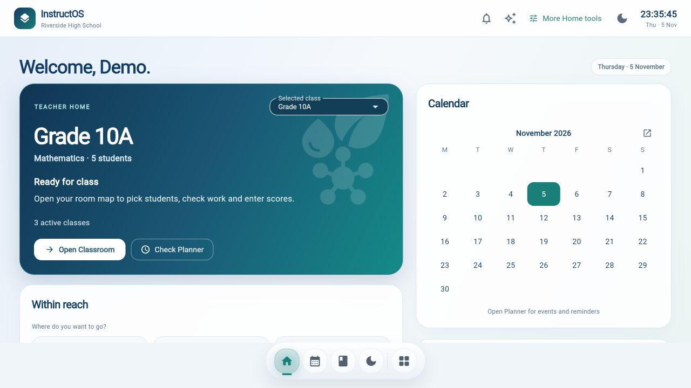
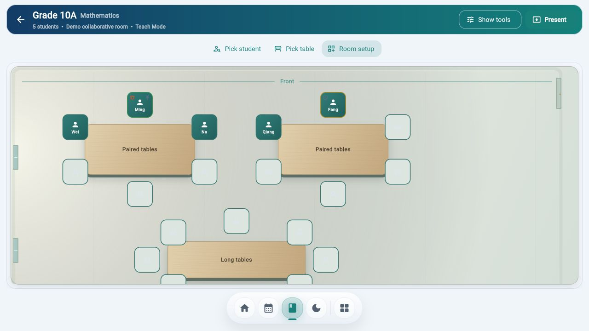

# PR report: cohesive InstructOS teacher experience

## Executive summary

A teacher could enter through the new Home but still reach an old purple dashboard, a separate seating screen, mismatched sign-in/launch, blank Messages panels and misleading academic defaults. This PR aligns the visual foundation, retires old route destinations, repairs the Messages layout, removes fictional classroom activity, and prevents two implicit paths from creating grades. It includes an evidence-based whole-product audit with remaining release blockers.

This is stacked on draft PR #69 (`feat/instructos-gradebook-20261105`), which contains the approved Home/Classroom/gradebook work and itself depends on PR #68. Starting an unrelated main-based implementation would omit that reviewed context. Neither dependency nor this PR is approved for autonomous merge or deployment.

## Files changed

- `docs/experience-review/continuation.md`
- `docs/experience-review/pr-report.md`
- `docs/experience-review/teacher-experience-audit.md`
- `docs/gradebook-integration-handoff.md`
- `lib/components/animated_page_background.dart`
- `lib/components/command_surface.dart`
- `lib/components/gradeflow_launch_experience.dart`
- `lib/components/home/approved_teacher_home.dart`
- `lib/components/home/teacher_home_presentation.dart`
- `lib/components/workspace_shell.dart`
- `lib/config/instructos_branding.dart`
- `lib/config/instructos_design.dart`
- `lib/nav.dart`
- `lib/os/os_dock.dart`
- `lib/os/os_launcher.dart`
- `lib/os/os_palette.dart`
- `lib/os/surfaces/class_surface.dart`
- `lib/os/surfaces/classroom_surface.dart`
- `lib/os/surfaces/home_surface.dart`
- `lib/os/surfaces/planner_surface.dart`
- `lib/providers/app_providers.dart`
- `lib/screens/admin_workspace_screen.dart`
- `lib/screens/category_management_screen.dart`
- `lib/screens/class_detail_screen.dart`
- `lib/screens/communication_hub_screen.dart`
- `lib/screens/export_screen.dart`
- `lib/screens/login_screen.dart`
- `lib/screens/native_gradebook_screen.dart`
- `lib/screens/school_data_inbox_screen.dart`
- `lib/screens/student_detail_screen.dart`
- `lib/screens/student_list_screen.dart`
- `lib/services/calculation_service.dart`
- `lib/services/grading_category_service.dart`
- `lib/theme.dart`
- `lib/widgets/branding/instructos_auth_card_shell.dart`
- `lib/widgets/branding/instructos_interactive_auth_background.dart`
- `test/academic_opening_safety_test.dart`
- `test/approved_teacher_home_bindings_test.dart`
- `test/calculation_completeness_test.dart`
- `test/canonical_planner_route_test.dart`
- `test/communication_layout_test.dart`
- `test/os_dock_activation_test.dart`
- `test/os_shell_surfaces_test.dart`
- `test/product_entry_accessibility_test.dart`
- `test/school_data_inbox_screen_test.dart`
- `tool/generate_brand_icons.py`
- `web/favicon.png`
- `web/icons/Icon-192.png`
- `web/icons/Icon-512.png`
- `web/icons/Icon-maskable-192.png`
- `web/icons/Icon-maskable-512.png`
- `web/icons/instructos-mark.svg`
- `web/index.html`
- `web/manifest.json`

Actual browser evidence images are additionally included under `docs/experience-review/before/` and `after/`.

## What changed

- Shared navy/teal theme, brand mark, calm background, typography hierarchy, accessible buttons/inputs and opaque cards across entry, teaching and support pages. Updated HTML/Flutter launch, sign-in, icons and manifest.
- Home primary action now fits at laptop height, readable class selector, real date-to-Planner navigation, honest reminder/shortcut copy.
- Direct class tool hub with real metadata instead of fabricated class-health/activity panels. Compact student roster.
- Old Dashboard route redirects to current Planner; old seating routes open the premium Classroom setup panel. Preserved wooden/teal room and sliding right tools.
- Messages list/thread get bounded layout constraints; narrow screens switch between channels and conversation. Admin loses duplicate counters and development roadmap. Shared support cards use the same calm surfaces.
- Missing marks remain incomplete, valid stored category weights are required, zero remains zero. Opening an empty class plan or adding a student no longer creates grades. New category defaults use previously confirmed weights; existing custom categories are preserved.
- Full audit, before/after screenshots and continuation notes keep known limitations visible.

## Risk level

**Amber UI/navigation with academic behavior requiring explicit human review before merge.** Stuart explicitly requested the comprehensive evaluation and improvements, and previously required that grades/weights never be invented. No authentication mechanisms, Firebase rules, model schemas, dependencies or backend permissions were modified. The discovered auth weakness is documented as a separate release blocker, not silently changed here.

## Preserved behavior

- Premium Classroom geometry, IDs, furniture semantics, on-map picking and right tools are preserved.
- Native Gradebook repository acknowledgement/leave guards, explicit policy review, backup/import and Excel export remain.
- Actual auth callbacks/endpoints and persistence services are unchanged; sign-in changes are visual/input affordances only.
- Existing class weights/marks are not migrated or overwritten. Explicit demo fixtures remain available only through demo setup.
- Real standalone gradebook and authoritative roster were not accessed or altered during this review.
- No Firebase, security rules, dependencies, deployment workflow, production data or communication sending behavior changed.
- Routing changes intentionally retire old dashboard/seating destinations while preserving old URLs through redirects.

## Verification results

```text
dart analyze lib test — passed, no issues
flutter test --reporter compact — passed, all 143 tests
flutter build web --release --no-wasm-dry-run --output build/cohesion-review — passed (97.4s)
git diff --check — passed
```

New meaningful regressions cover missing/null/zero marks, valid weights and student isolation, class-plan opening without seeding, student add without full marks, preserved custom weights, actual class hub content, date navigation, keyboard dock activation, phone/text-scale sign-in and Messages layout on desktop/phone. A stale badge-copy expectation was corrected after the full suite surfaced it; all tests were rerun successfully.

Browser verified Home → Classroom → Full Gradebook, on-map student pick, right tools open/close, room setup redirect/finish, dock and calendar date navigation, student record, results/export/settings, recovery empty states, Knowledge Hub, Admin, Messages and Whiteboard stroke/return. Phone/dark sign-in checked. A synthetic demo score was set to zero, acknowledged Saved, persisted through reload, and restored to its original demo value. Excel export downloaded and the XLSX ZIP validated with two sheets (`All Classes`, `Assessments`). No real grades were used.

## Screenshots / visual QA

See [whole-product audit](teacher-experience-audit.md) for page-by-page coverage and evidence limits.

| Entry | Home | Classroom |
| --- | --- | --- |
|  |  |  |

Additional actual captures include phone/dark entry, Planner, roster/student record, Gradebook, class hub, setup, settings, export/results, Messages/Admin, Knowledge Hub, recovery and Whiteboard. Before images document the rejected hybrid; the retired purple Planning Hub is under `before/`.

## Known limitations

- **Release hold:** existing local-account registration/login ignores password validation on the fallback path. Needs separately approved security repair/review; no real account creation tested here.
- **Release hold:** legacy FinalExamService/ExamInputScreen persistence can swallow errors and leave during pending writes. Native Gradebook's stronger guarantee must not be generalized to that older screen.
- Existing custom policies are preserved. Native confirmed-policy grades remain incomplete until explicitly reviewed/applied; legacy advanced aggregation/report parity requires separate synthetic acceptance fixtures.
- Google/Drive/Firebase/cloud/offline import and real permission behavior not validated. No staff messages sent or destructive recovery actions executed.
- Secondary student/result/report pages still have opportunities to reduce repeated context; dense laptop Gradebook could use a compact-toolbar option.
- CJK font first-load/offline behavior needs deployment validation. Audio/voice/shared-folder placeholders remain explicitly labelled.
- This review is not authorization to import real school data, merge the stack or deploy.

## Rollback notes

Revert this PR's commits on its feature branch. There is no automatic data migration or real-data rewrite to reverse. Do not reset real browser gradebook storage as a rollback technique. Previously stored category policy/grades remain intact; a later teacher-initiated setup change requires its own reviewed recovery path.

## Human review required

Stuart should review launch/sign-in → Home → selected class → Classroom → Gradebook → Planner and the roster/support screens against the retained premium design. Review the academic completeness/default-policy changes before merge. Agree separate scope for auth security and legacy save reliability, then test cloud/policy/export parity with synthetic fixtures before any real-school rollout. No merge/deployment approval is implied.
