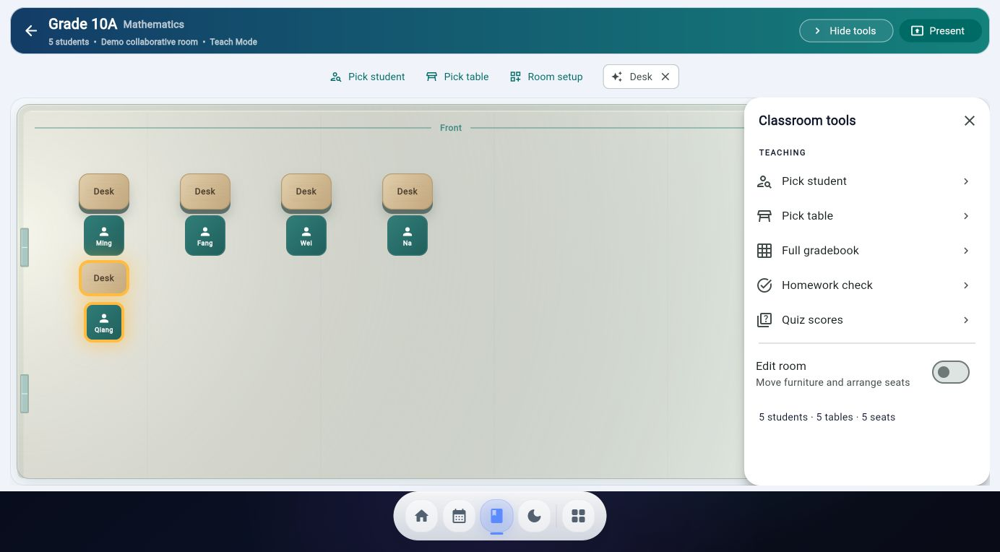
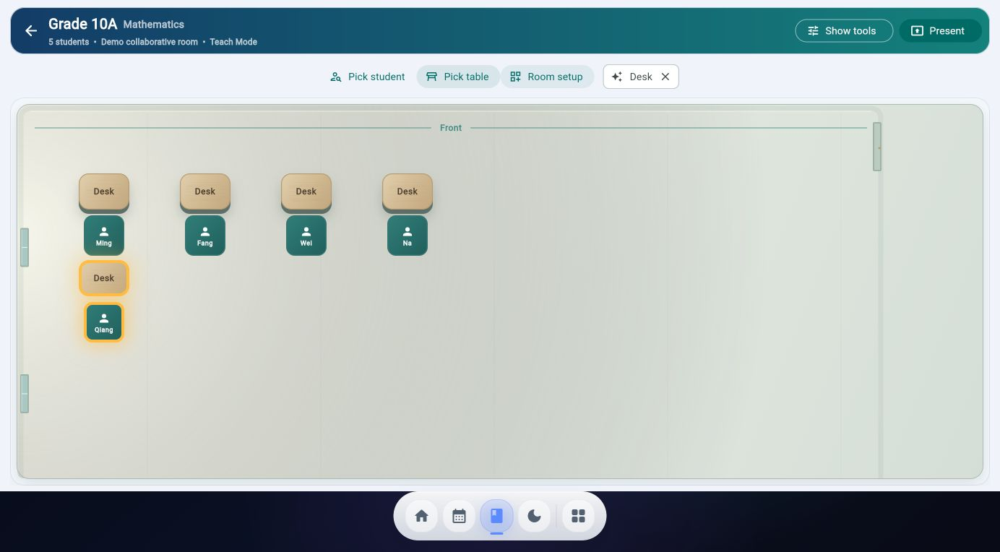
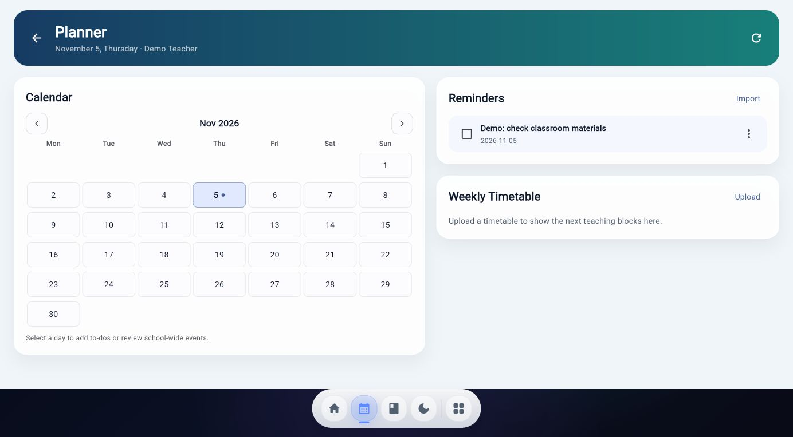
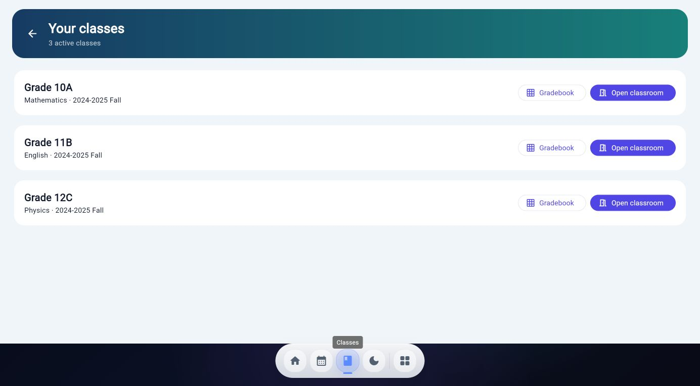
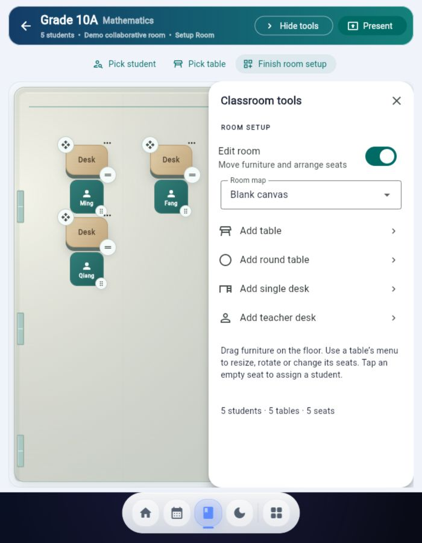

# Gradebook integration and Classroom correction

## Executive summary
Adds the native gradebook to the newer Home branch, then corrects the rejected hybrid Classroom. The bottom tools tray and old modal picker are removed from Classroom. Tools slide from the right; picking highlights actual seats/tables; room editing shares the same floor and furniture. Planner and class navigation use a simpler matching shell. This is a corrected review candidate, not approved visual parity or a production release.

Stacked on draft PR #68 (`feat/approved-teacher-home-integration-20261029`, b90f8b3), because Stuart explicitly requested the newer Home. Neither draft has been merged. Review the dependency before merging this PR. Do not deploy automatically.

## Files changed
Core integration:
- lib/screens/native_gradebook_screen.dart
- lib/services/gradebook_workspace.dart
- lib/services/gradebook_import_plan.dart
- lib/repositories/local_repository.dart
- lib/nav.dart

Classroom/design/navigation:
- lib/components/classroom/classroom_materials.dart
- lib/components/classroom/classroom_tools_drawer.dart (legacy component retained, not used by the new Classroom)
- lib/components/seating/seating_canvas.dart
- lib/components/seating/seating_designer_view.dart
- lib/os/surfaces/classroom_surface.dart
- lib/os/surfaces/class_directory_surface.dart
- lib/os/surfaces/planner_surface.dart
- lib/os/surfaces/home_surface.dart
- lib/os/surfaces/teach_surface.dart
- lib/os/gradeflow_os_shell.dart
- lib/os/os_dock.dart
- lib/os/os_app_model.dart
- lib/os/os_launcher.dart
- lib/os/os_notification_shade.dart
- lib/os/os_widget_host.dart

Tests and evidence:
- test/classroom_surface_test.dart
- test/os_dock_activation_test.dart
- test/gradebook_workspace_test.dart
- test/premium_classroom_adapter_test.dart
- docs/gradebook-integration-20261105.md
- docs/design-integration-hold-20261105.md (historical rejection and acceptance contract)
- This report and synthetic demo screenshots.

## What changed
- Right panel starts closed, animates horizontally and does not resize the map. No bottom Class tools tray. Fewer top-level controls; gradebook/homework/quiz actions live in the right panel.
- Pick student chooses a seated student without repeats until a cycle completes. Pick table chooses an occupied table. Gold outlines/glow highlight the actual map records. No modal picker or assignment mutations.
- Room editing exposes saved-map selection and furniture additions in the right panel; existing table drag/resize/rotate and seat assignment actions remain on the map. Presentation keeps premium furniture and floor materials.
- Corrected occupied-seat fill so white names remain legible on teal in both themes.
- Planner removes the old sidebar, metric clutter and inactive Search/Settings buttons. Calendar, persistent reminders and timetable controls remain connected to existing preferences.
- `/os/classes` provides direct Classroom and Gradebook links using existing active class records. OS dock, launcher, Home and OS class-selection links use it; administrative legacy routes remain available separately through an explicitly labelled class-records/imports control.
- The shell physically reserves dock space rather than relying only on MediaQuery padding. Dock shortcuts now activate through `onTap` instead of `onTapUp`, including semantic activation. Removed inert teach-mode Whiteboard/Timer shortcuts.
- Gradebook: category tables, exam/summary view, assessment creation, validated paste, undo, Excel export, JSON archive backup and explicit standalone-format import. Missing scores stay missing, with no automatic full marks. Confirmed policy is GPA 40%, exam 60%, with 20/30/30/20 participation/homework/quizzes/classwork within GPA. Existing differing policies require explicit application.
- New academic workspace awaits repository persistence acknowledgements. Failed inputs remain editable; history failures are separately reported. Selected local academic writes reject false acknowledgements and reload cache after failure.

## Risk level
Red academic-write path from the original integration; Amber bounded UI and navigation correction. Implementation explicitly requested by Stuart. Keep draft pending human visual/security review. No production operations, new permissions, real school-data transfer or migration.

## Preserved behavior
Auth, Firebase rules, model schemas, dependencies, lockfiles and deployment workflows unchanged. Same stable class/student/table/seat IDs and saved room geometry. Gradebook route reused. Existing administrative screens are retained rather than deleted. Standalone live gradebook and its scores remain untouched. Legacy score services and global issue #62 remain outside scope.

## Verification results
- Targeted analysis of OS surfaces/navigation, seating adapters and revised tests: no issues.
- 55 tests passed across classroom, premium adapter, academic workspace, OS surfaces, Home bindings/integration panel, registry/destinations and seating canvas/service suites.
- Final targeted Classroom/OS surface repeat after small navigation/copy changes: 12 tests passed.
- Dedicated dock semantic-activation regression: Planner, Classes and Home destinations verified through accessibility tap actions.
- Release web build: `flutter build web --release --no-wasm-dry-run --no-web-resources-cdn --no-pub --output build/gradebook-review` passed.
- `git diff --check` passed.
- Browser demo: Home -> Classes -> Classroom; map picking and right-panel open/close; panel -> Quiz scores -> Ming -> full class gradebook; gradebook -> Classroom. Planner reminder creation survived reload. Bottom Home/Planner/Classes, theme control and 700px room editor checked. These checks use local synthetic data.
- Preview server intentionally blocks Firebase connections and service workers; corresponding console warnings are expected. Cloud persistence was not tested.

## Screenshots / visual QA
Current correction screenshots use synthetic demo students and the demo's saved five-desk geometry. No fixed fictional six-table layout is copied over existing rooms.

## Known limitations
- This improves the reported primary paths; it does not convert every legacy administrative/student/results screen into the newer design. Home's remaining specialized destinations need their own design acceptance pass.
- Room setup still uses canonical saved-layout geometry and existing editing mechanics; this is not a wholesale transplant of the synthetic preview builder. No automatic rearrangement of real rooms.
- Classroom picker considers seated students; unseated students must first be assigned. Table picking considers occupied tables.
- Full phone workflow and all dark-theme destinations not comprehensively tested. Classroom dark mode and 700px room editor visually checked.
- Cloud/emulator writes and security compatibility remain unverified. Sequential backup import is not transactional; preserve the source backup, and retry can complete partial imports by matching assessment names.
- Standalone import requires exact student IDs and refuses guessed mappings. Native JSON backups are archives; current import UI accepts the standalone format only.
- No auto-resolution of issue #62 for legacy callers.

## Rollback notes
Revert this PR as a unit. No schema migration or deployment accompanies it. Keep backups before explicitly applying syllabus weights or importing scores. Previous rejected screenshots/report remain historical evidence, superseded by this report.

## Human review required
Stuart: assess Classroom panel behavior, on-map picks, room-editing controls, Planner and the primary navigation together before removing the visual hold. Reviewer: inspect academic save/history/import failure behavior and cloud security compatibility before merge. Do not merge or deploy automatically.
