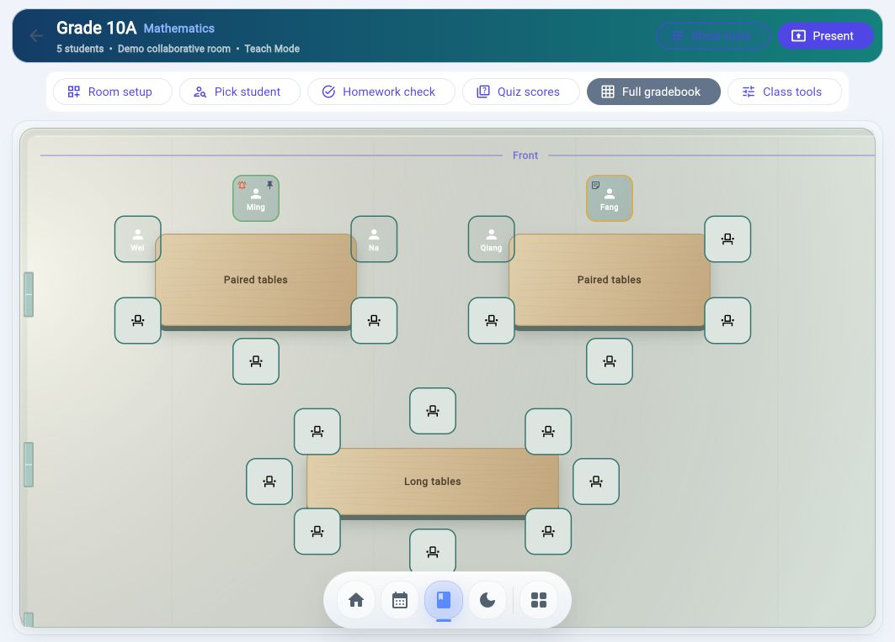
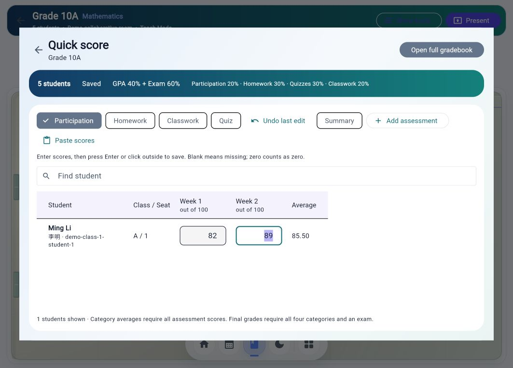
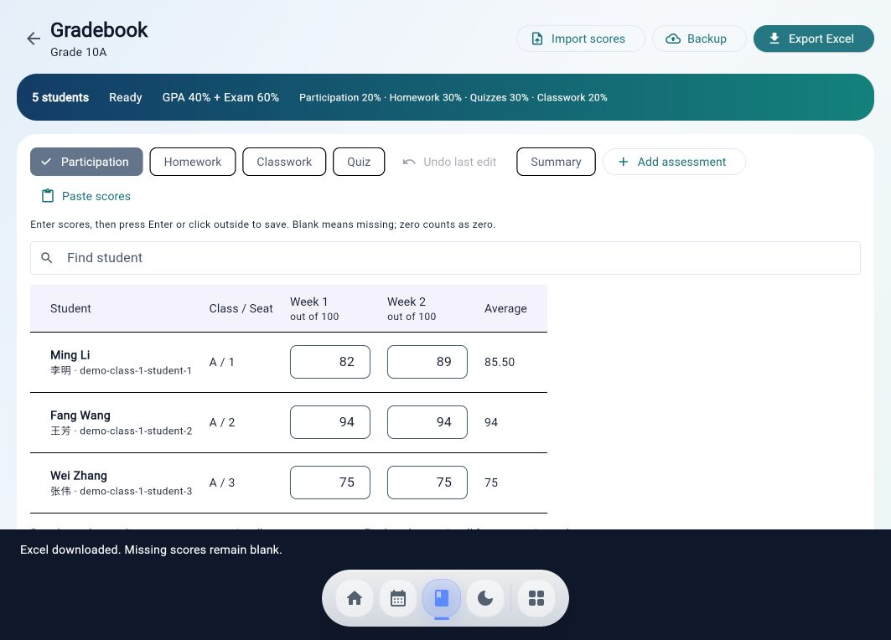

> **HOLD — design regression reported by Stuart. Do not merge.** The current preview mixes legacy screens with the approved new design. See [design integration hold](docs/design-integration-hold-20261105.md). Previous test results do not establish visual or navigation acceptance.

# Native gradebook and approved Classroom integration

## Executive summary
Integrates the score-entry workflow into the existing InstructOS class route and approved Home branch. Occupied seats open a student gradebook; the horizontal Classroom toolbar opens Homework, Quizzes or the full class gradebook. Uses the recovered premium wooden-table / teal-seat materials while preserving real room geometry.

This is stacked on PR #68 (`feat/approved-teacher-home-integration-20261029`, b90f8b3), because Stuart explicitly requested the newer Home. Main was inspected, but starting from main would omit that approved Home integration. Review/merge the dependency first; do not merge this directly without reconciling its base.

## Files changed
- lib/screens/native_gradebook_screen.dart
- lib/services/gradebook_workspace.dart
- lib/services/gradebook_import_plan.dart
- lib/nav.dart
- lib/repositories/local_repository.dart
- lib/components/classroom/classroom_materials.dart
- lib/components/classroom/classroom_tools_drawer.dart
- lib/components/seating/seating_canvas.dart
- lib/components/seating/seating_designer_view.dart
- lib/os/surfaces/classroom_surface.dart
- test/gradebook_workspace_test.dart
- test/premium_classroom_adapter_test.dart
- This report and synthetic demo screenshots.

## What changed
- Native category tables, exam/summary view, new assessments, validated block paste, undo, Excel export and JSON archive backup.
- Missing marks remain missing. No default full marks. Final results require all categories and an exam. Confirmed syllabus policy is explicit: GPA 40%, exam 60%; participation 20%, homework 30%, quizzes 30%, classwork 20% within GPA. Existing differing policies require an explicit apply action.
- New workspace confirms repository writes before reporting success; failures retain unsaved input. History failures are separately reported. Selected local academic writes now reject false persistence acknowledgements and reload the preferences cache on failure.
- Standalone backup import requires explicit class selection and exact student IDs; validates scores and conflicts before writes. Replacement is explicit. Null source marks never erase existing marks.
- Premium appearance is opt-in to the canonical seating renderer. Table types, coordinates, seat bounds, IDs, placements, notes and drag behavior remain authoritative. Tools open at the bottom.

## Risk level
Red academic-write path; Amber UI/import/export. Implementation was explicitly requested by Stuart. Keep draft pending human/security review. No production operations performed.

## Preserved behavior
Firebase rules, auth, data models, dependencies/lockfiles and deployment workflows unchanged. Existing gradebook route is reused, with a new screen and exit guard. Legacy score services remain unchanged; this is not a global fix for issue #62. No live school records were seeded, transferred or edited. Standalone gradebook remains separate and intact.

## Verification results
- Targeted Flutter analysis of 12 changed source/test files: no issues.
- 59 tests passed across gradebook_workspace, premium_classroom_adapter, approved_teacher_home_bindings, classroom_surface, teacher_home_integration_panel, os_shell_surfaces, os_app_registry, connected_destinations, full_screen_seating, seating_service and seating_canvas.
- `flutter build web --release --no-wasm-dry-run --no-web-resources-cdn --no-pub --output build/gradebook-review`: passed.
- `git diff --check`: passed.
- Browser synthetic demo: Classroom Quiz button -> Ming seat -> selected Quiz table; Participation score changed to 82, full gradebook showed average 85.50, reload preserved average. Excel download completed successfully.
- Browser QA caught a tools action below the panel fold; action order corrected and existing tests rerun successfully.

## Screenshots / visual QA
Synthetic demo only; no real students.

## Known limitations
- Cloud/emulator persistence and security behavior not verified end-to-end. Local demo persistence verified.
- Import is sequential, not transactional; interrupted imports may partially complete. Retry matches assessments by name. Preserve original backup.
- Different native student IDs require a future explicit mapping workflow; import refuses guesses.
- Native JSON backup is an archive; current import UI accepts the standalone gradebook format only.
- Legacy score write callers and issue #62 remain outside scope.
- Recovered preview-only timer, lesson focus and finish-class controls are not introduced as fake actions. Presentation view and other legacy destinations still need separate visual reconciliation; this scope covers the interactive Classroom and gradebook.
- Full mobile and dark-theme visual QA remain outstanding.

## Rollback notes
Revert this PR as a unit. No schema migration, dependency change or production deployment accompanies it. Applying syllabus weights or importing scores is a user action; retain backups before those operations.

## Human review required
Stuart: visual review against the recovered Classroom and approval of the full grading workflow. Reviewer: academic persistence/history and import failure semantics, cross-class protections and cloud rules compatibility before merge. Do not merge or deploy automatically.

