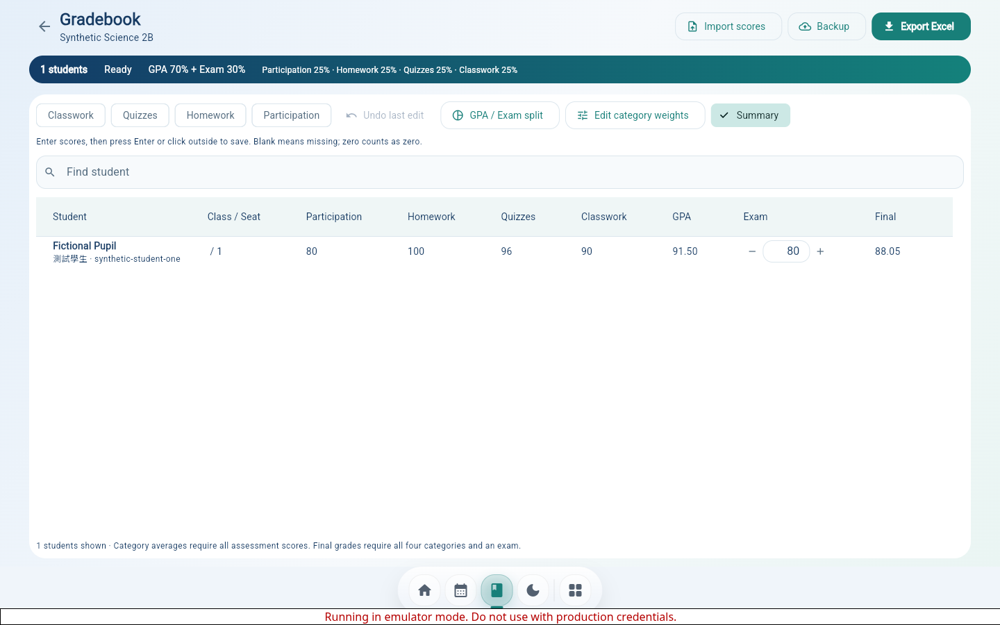

# Native Gradebook: release identity and acceptance — 17 November 2026

## Exact live release baseline

Verified directly against Firebase Hosting metadata and public assets before product edits:

| Item | Verified value |
|---|---|
| Production site | https://gradeflow-20260113.web.app |
| Hosting version | `94fb48744253991d` (FINALIZED) |
| Hosting release | `1794832457975000` |
| Published | 16 November 2026, 20:34:17 Taiwan time (12:34:17 UTC) |
| Release workflow | GitHub run `43866754004`, successful |
| Application commit | `31a1a3ec6f22275872c0fa8073b8da446614a2e8` |
| Application tree | `28dc417b6252ebbafce33dfacf3d3475d006bb27` |
| Live `main.dart.js` | 5,729,126 bytes; SHA-256 `75cf4bb1b9ca55899a1263d29a87f675b56ceae222fd018e97dba08babf1dd7a` |
| Main control branch | `107bae5` — release controls and separate Messages containment; not the deployable application tree |
| Unreleased communication prototype | PR #148; separate from this change and the live app |

Read-only Hosting channel inspection also distinguishes the named previews:

| Channel | Last publication (Taiwan time) | Status |
|---|---|---|
| live | 16 November 2026, 20:34 | Latest deployed integrated release |
| classes-v2 | 12 November 2026, 13:54 | Older preview |
| design-lab | 12 November 2026, 11:13 | Older preview |
| login-boxes | 12 November 2026, 09:57 | Older preview |
| classroom-v2 | 10 November 2026, 15:23 | Older preview |

Other listed channels are before-release backups, not newer feature releases. No channel was published, deleted or extended during inspection.

The public JavaScript exactly matches the verified local release package. The publisher pins application 31a1a3e and artifact 14220518481 from run 43856464565. Firebase reports one Hosting site in this project. This identifies the live build; “V2” alone does not identify a release.

The native grading screen, workspace and export projection at this baseline are byte-identical to grading recovery commits 94c855e and d15f2b7. Across fetched grading-path history, two commits were not direct ancestors of 31a1a3e; blob comparison confirmed the newer equivalent grading/export implementation was already ported into the live source. The communication prototype has those same grading blobs. Older feature/preview branches are not evidence of a later production release.

## Scope: the new grading workflow

Canonical entry: `/os/class/{classId}/gradebook`, rendered by `NativeGradebookScreen`. Coursework assessments, summary exam entry, GPA/exam split and `Export Excel` are tested here. The separate older Exam/Results/CSV routes are not used to certify this workflow.

## Concrete fix

The native Gradebook status strip hardcodes Participation 20%, Homework 30%, Quizzes 30%, Classwork 20% even when the saved categories have valid custom weights. Calculation and Excel projection already use saved weights, so the label can contradict the actual result.

Render this strip from the loaded, validated category records instead. Show a loading label before hydration and a review label for an unsupported/invalid policy. Preserve score calculations, saves, category order, default policy, table layout and export implementation. No data or schema migration is required. The candidate native screen blob is `302025743cf224311e02f0813b65f468059ff0fc`; this is the only application-source file changed.

## Fictional browser acceptance

Use the existing loopback-only Auth/Firestore fixture with four custom 25% categories and an initial 40/60 class split. The committed containment fixture exactly matches the active approved rules source (SHA-256 `3a8564410ef9c8122830dbfe868d2f1c9f6835ae8f176809680dac04d146ec8c`). All names, classes and marks are fictional. The new test blocks and checks for production Firebase API requests.

The native UI must show saved 25/25/25/25 category weights. Change the quiz from 94 to 96 through its native assessment field, reload, and verify coursework 91.5 from Homework 100, Quizzes 96, Classwork 90 and Participation 80. Enter exam 80, zero, clear and 80 through the Summary field; each must survive reload and match emulator storage.

Invalid 101 must remain available for correction while the saved mark stays 80; native export must reject unfinished edits. Correct the entry, use the native GPA/exam dialog to save 70/30, reload and verify final grade 88.05. Download `grades_all_classes.xlsx`, parse its OOXML with Python's standard library, and verify the actual summary values H:N are 100, 96, 90, 80, 91.5, 80, 88.05, with no overriding formulas. Capture the native dense table, not the older Results cards.

## Verification results

- Full-project Flutter analysis: clean.
- Targeted Gradebook workspace and export projection suite: 16 passed.
- Guarded debug web build: passed (134.0 seconds).
- Actual native browser acceptance: **1 passed**, all native UI, persistence, validation, weighting-dialog and downloaded-XLSX assertions passed; emulator script exit 0 and no production Firebase request observed.
- Production-mode release build: passed (245.3 seconds); unchanged Studio distribution included and verified byte for byte (all files). This is a local review candidate, not a published version. Candidate JavaScript SHA-256: `a19a1be156bbf032fdfd579eb7dea3ad26cb42ebbe998b6a1b89e1d168ab3377`.

The earlier integrated release's broader Flutter, Studio, class/roster and room checks remain prior evidence, not fresh passes for this change. This is not live school-data or physical-device acceptance.

## Review artifacts



[Actual fictional Excel workbook](native-gradebook-20261117.xlsx), SHA-256 `0c0edad9ce11a15a4a536198dfd161bf48f7ba1b9498abab89329e360b61f5dd`. Both All Classes and Assessments worksheets were read back; summary and assessment scores match the native UI, and there are no overriding formulas. The 1440 × 900 screenshot was visually reviewed for the actual new dense table, complete controls and legible saved-weight strip. These are local emulator review artifacts, not production school data or evidence that the candidate has been published.

## Reproduction

Build the guarded debug app using the emulator flags from `.github/workflows/gradeflow-reliability-browser.yml`, preserving Studio under `build/web/teaching-studio`, then run:

```sh
PLAYWRIGHT_DISABLE_FORCED_CHROMIUM_PROXIED_LOOPBACK=1 \
  ./staging-tests/node_modules/.bin/firebase emulators:exec \
  --project demo-gradeflow-v2-staging --config firebase.native-gradebook-test.json \
  --only auth,firestore \
  "node staging-tests/seed-native-gradebook.mjs && node node_modules/@playwright/test/cli.js test --config=playwright.native-gradebook.config.ts"
```

Use a fresh local emulator. Do not substitute a production project. The Python helper reads worksheet XML and never evaluates formulas or extracts archive paths.

## Review, rollout and rollback

This work targets the verified application integration branch, rather than old application files on main. It does not change production rules, authentication, IAM, dependencies, Hosting controls, school records or Messages availability. No merge or deployment is included. The current live app remains 31a1a3e until a separately reviewed release is approved.

Rollback is a revert of the native display change before release. Do not roll back the approved Messages containment. The optional test harness and report have no production runtime effect.
